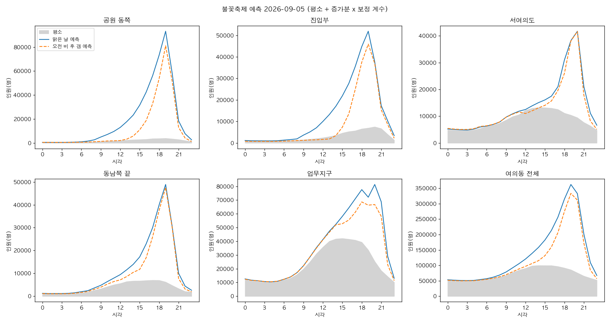
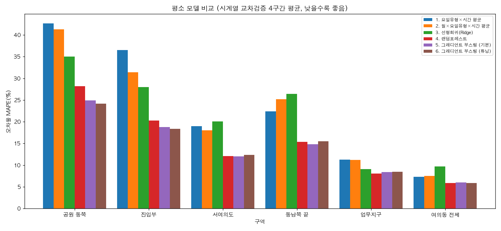

# 여의도 불꽃축제 구역별·시간대별 인파 예측

공공데이터로 **서울세계불꽃축제 날 여의도의 구역별 × 1시간 단위 인원**을 예측합니다.

2026 하반기 공공데이터분석대회 TEAM 치앙마이 프로젝트 「축제 인원 예측 및 통신 최적화」에서 **인원 예측 파트**의 코드와 기록을 모은 레포입니다. 예측 결과는 이동기지국 대수·배치를 정하는 통신 파트의 입력으로 쓰였습니다. 통신 파트는 이 레포에 들어 있지 않습니다.

```
예측 인원 = 평소 인원(회귀 모델) + 축제 증가분 × 보정 계수
```

| 요소 | 의미 | 구하는 법 |
|---|---|---|
| 평소 인원 | 축제가 없었다면 그 시각 그 구역에 있었을 사람 수 | 행사 없는 토·일·공휴일 367일로 학습한 그래디언트 부스팅 회귀 |
| 축제 증가분 | 축제 때문에 늘어난 사람 수 | 2022~2025년 불꽃축제 4회의 (실제 − 평소) 시간대별 평균 |
| 보정 계수 | 날씨에 따른 증가분 비율 | 비 온 2018년 ÷ 같은 시기 맑은 해(2017·2019) 평균. 맑은 날은 1 |

**핵심 결과**
- 평소 모델: 6가지 방법을 4구간 시계열 교차검증으로 비교했습니다. 그래디언트 부스팅의 6구역 평균 오차율이 **14.2%**로 가장 낮았습니다 (단순 평균 22~23%, 선형회귀 21.4%, 랜덤포레스트 15.0%).
- 불꽃축제 예측: 최근 4회를 하나씩 빼고 맞혀 봤습니다. **여의동 전체 피크 인원 오차는 ±9% 이내였고, 피크 시각은 4회 모두 맞았습니다.**



---

## 왜 이렇게 설계했나

- 문제를 "몇 명 오나"가 아니라 **"언제, 어디에"**로 정했습니다. 통신 부하는 하루 총인원이 아니라 순간 동시 인원에서 생기기 때문에, 일 단위·시군구 단위 방문객 수로는 대응 시각이나 구역을 정할 수 없습니다.
- 불꽃축제는 1년에 한 번이라 표본이 7회뿐입니다. 크기가 비슷한 회차는 4회입니다. 이것만으로 모델을 학습하면 과적합되고, 평소와 섞어 학습하면 수백 일인 평소 데이터에 축제 효과가 묻힙니다.
- 그래서 **표본이 충분한 평소 인원만 학습**하고, 축제 효과는 실제 값에서 직접 계산해 분리했습니다. 증가분 곡선의 모양은 7회 모두 비슷했습니다 (상관계수 0.93 이상).

## 데이터

| 데이터 | 역할 | 출처 |
|---|---|---|
| 집계구 단위 서울 생활인구 (KT 통신 신호 기반 추계 인구) | 예측 대상 | 서울 열린데이터광장 [OA-14979](https://data.seoul.go.kr/dataList/OA-14979/F/1/datasetView.do) |
| 서울 집계구 경계 (2016, UTM-K) | 구역 정의 | 서울 열린데이터광장 [서울 생활인구 자료실](https://data.seoul.go.kr/dataVisual/seoul/seoulLivingArchive.do) |
| 서울시 문화행사 정보 (19,583건) | 행사일 달력 | 서울 열린데이터광장 [OA-15486](https://data.seoul.go.kr/dataList/OA-15486/S/1/datasetView.do) |
| 시간별 날씨 (ERA5 재분석값) | 설명 변수 | [Open-Meteo Historical Weather API](https://open-meteo.com/en/docs/historical-weather-api) |
| 목록에 없는 큰 행사·집회 7건 | 행사일 보완 | 뉴스 기사로 날짜 확인 ([`manual_events.csv`](data/raw/events/manual_events.csv)에 출처 기록) |

- 기간: 평소 모델은 2023.01~2026.07 (1,301일)을 썼습니다. 과거 불꽃축제는 2017.09, 2018.10, 2019.10, 2022.10 네 달을 썼습니다.
- 구역: 여의동 68개 집계구 중 축제일 인파의 84%가 몰리는 큰 집계구 5개(공원 동쪽, 진입부, 서여의도, 동남쪽 끝, 업무지구)와 여의동 전체, 모두 6개입니다. 지도는 [`docs/여의도_집계구_지도.html`](docs/여의도_집계구_지도.html)에 있습니다 (내려받아 브라우저로 열기).

## 전처리

| 단계 | 하는 일 | 남는 양 |
|---|---|---|
| 1 | 서울 전체 생활인구 월별 ZIP | 약 55GB |
| 2 | ZIP을 풀지 않고 한 줄씩 읽어 여의동 68개 집계구만 추출, 원본 삭제 | 약 180MB |
| 3 | 6개 구역 × 1시간 표로 집계 | 33,864시간 |
| 4 | 날씨, 달력 변수(요일·공휴일·계절·추세) 결합 | 같음 |
| 5 | 평일 제외 (여의도는 평일 낮 인원이 주말의 약 2배, 축제는 토요일) | 429일 |
| 6 | 공식 행사 달력의 행사일 제외 | **367일 ≈ 8,800시간** |

원본에서 처리한 문제
- 2019년 이전 파일은 UTF-8, 이후 파일은 CP949입니다. 자동으로 판별해 읽습니다.
- 3명 이하를 가린 `*` 값은 0으로 바꿨습니다.
- 2024-06-20 데이터는 코드 뒤에 공백이 있고 시각이 한 자리로 적혀 있어 형식을 맞췄습니다.
- 2026-05-02와 05-04~09는 원본 파일이 비어 있어 누락으로 처리했습니다.
- 행사 달력은 여의도 안의 야외 행사이면서 기간이 14일 이하인 것만 행사일로 쳤습니다 (47건, 120일).
- 처음 모델을 비교할 때 한 구간의 오차가 56%로 튀었습니다. 원인을 추적해 보니 문화행사 목록에 없는 **국회 앞 대규모 집회**였습니다. 뉴스로 날짜를 확인해 행사일에 추가했습니다.
- 2017~2019년 평소 데이터를 학습에 넣을지는 직접 검증해서 정했습니다. 최근 모델을 그 시기에 적용하면 오차가 최근의 1.5~2배였고, 업무지구는 8~13% 높게 예측했습니다. 그래서 그 시기 데이터는 학습에서 뺐습니다.

## 평소 모델 비교

- 입력 변수는 18개입니다: 시각, 요일·공휴일·다음 날 휴일 여부, 월·1년 주기 sin/cos, 추세, 기온·체감온도, 강수(그 시간·최근 3시간·하루)·적설, 습도·풍속·구름량.
- 예측 대상은 `log(1+인원)`이고, 구역마다 모델을 하나씩 만들었습니다.
- 검증은 **시계열 교차검증**입니다. 6개월씩 4구간을 시험 구간으로 두고, 그 앞 기간 전체로 학습했습니다. 무작위로 섞으면 같은 날의 다른 시각이 학습과 시험에 나뉘어 들어가 점수가 부풀기 때문입니다.
- 튜닝은 학습 기간의 마지막 20%로만 했습니다.

| 방법 | 공원 동쪽 | 진입부 | 서여의도 | 동남쪽 끝 | 업무지구 | 여의동 전체 | 6구역 평균 |
|---|---|---|---|---|---|---|---|
| 요일유형×시간 평균 | 42.7 | 36.5 | 19.0 | 22.4 | 11.3 | 7.3 | 23.2 |
| 월×요일유형×시간 평균 | 41.3 | 31.4 | 18.0 | 25.2 | 11.2 | 7.5 | 22.4 |
| 선형회귀 (Ridge) | 35.0 | 28.0 | 20.1 | 26.4 | 9.1 | 9.7 | 21.4 |
| 랜덤포레스트 | 28.2 | 20.3 | 12.1 | 15.4 | 8.1 | 5.9 | 15.0 |
| **그래디언트 부스팅 (채택)** | **24.9** | **18.8** | **12.0** | **14.8** | 8.4 | 6.0 | **14.2** |
| 그래디언트 부스팅 + 튜닝 | 24.2 | 18.4 | 12.4 | 15.5 | 8.5 | 5.9 | 14.2 |

MAPE(%), 4구간 평균, 낮을수록 좋음

채택 이유
- 6구역 평균이 가장 낮습니다. 불꽃축제 인파가 몰리는 강변 구역(공원 동쪽, 진입부)에서는 랜덤포레스트보다 2~3%p 낮습니다.
- 선형회귀가 단순 평균과 비슷했습니다. 변수끼리 얽힌 효과(시각마다 다른 기온 효과 등)가 크다는 뜻이라 트리 계열 모델이 맞습니다.
- 튜닝은 효과가 없었습니다. 후보 8개의 점수가 13.1~13.3%로 거의 같아 기본 설정을 썼습니다.
- 변수 제거 실험 결과: 날씨를 빼면 강변 구역만 나빠집니다 (공원 동쪽 24.9 → 29.7%). 추세를 빼면 더 크게 나빠집니다 (→ 37.0%).



## 축제 증가분과 보정 계수

- **크기**는 2022~2025년 4회로 잡았습니다 (여의동 전체 피크 증가분 평균 27.7만 명). 2017~2019년은 크기가 약 30% 작고 피크가 1시간 늦어서, 모양이 해마다 유지된다는 근거로만 썼습니다.
- **보정 계수**는 2018년 데이터로 구했습니다. 이날은 오전에 비가 오고 오후에 갰습니다. 계수는 15시 0.45, 17시 0.72, 19시 0.92입니다. 즉 오전에 비가 오면 사람이 안 오는 게 아니라 **늦게 몰려옵니다**. 사례가 1회뿐이라 예측값이 아니라 "오전 비 후 갬" 시나리오로만 제시합니다.

| 구역 | 피크 인원 오차 (2022, 2023, 2024, 2025) | 피크 시각 |
|---|---|---|
| 여의동 전체 | +5.9%, +7.4%, −9.0%, −3.1% | 4회 모두 맞음 |
| 공원 동쪽 | −3.1%, +0.5%, −8.3%, +12.7% | 4회 모두 맞음 |
| 진입부 | +12.7%, +15.7%, −12.8%, −11.8% | 4회 모두 맞음 |
| 동남쪽 끝 | +21.9%, +1.4%, −19.4%, +2.7% | 4회 모두 맞음 |
| 서여의도 | +9.5%, +10.8%, −9.2%, −8.6% | 4회 모두 맞음 |
| 업무지구 | −3.8%, +0.3%, −0.8%, −1.6% | 1~2시간 어긋남 |

## 실행

```bash
pip install -r requirements.txt
python3 scripts/baseline_model.py             # 평소 모델 학습·검증 (약 1분) → outputs/baseline/
python3 scripts/model_compare.py              # 6가지 방법 비교·튜닝·변수 중요도 (약 25분) → outputs/model_compare/
python3 scripts/fireworks_increment.py        # 불꽃축제 7회 증가분, 과거 달 검증 → outputs/fireworks/
python3 scripts/predict_fireworks.py 2026-09-05                      # 예측표 (날씨는 평년값)
python3 scripts/predict_fireworks.py 2026-09-05 --tmax 28 --tmin 20  # 최고·최저 기온 지정
python3 scripts/predict_fireworks.py --backtest                      # 하나씩 빼고 검증
```

레포에 든 가공 데이터(`data/processed/`)만으로 위 명령이 모두 돌아갑니다.

### 처음부터 다시 만들기

원본은 용량 때문에 레포에 넣지 않았습니다. 아래 순서로 받으면 됩니다.

```bash
python3 scripts/fetch_yeouido_pop.py 202301 202607   # 생활인구 (월 1.2GB씩 받아 여의동만 남김, 수 시간)
python3 scripts/fetch_yeouido_pop.py 201709          # 과거 불꽃축제 달: 201709, 201810, 201910, 202210
python3 scripts/fetch_weather.py 2023-01-01 2026-07-31
python3 scripts/build_panel.py                       # → data/processed/yeouido_zone_hourly.csv
python3 scripts/build_event_calendar.py              # → 행사 목록·달력
```

- 과거 불꽃축제 전후 날씨(`weather_yeouido_hourly_past.csv`)는 같은 API와 같은 변수로 따로 받아 둔 파일입니다. `fetch_weather.py`는 항상 `weather_yeouido_hourly.csv`에 덮어쓰므로, 과거분을 다시 받으려면 받은 뒤 파일 이름을 바꿔야 합니다.
- `build_event_calendar.py`를 돌리려면 문화행사 정보(OA-15486) CSV를 `data/raw/events/seoul_cultural_events.csv`에 두어야 합니다.
- `make_yeouido_map.py`를 돌리려면 집계구 경계 shp ZIP(`data/raw/boundary/`)과 2024년 10월 생활인구 ZIP(`data/raw/living_pop/`)이 필요합니다. 지도는 레포 루트에 만들어집니다.

## 구조

```
scripts/      수집 → 전처리 → 모델 → 예측 스크립트 9개
data/
  raw/events/manual_events.csv   직접 확인해 추가한 행사 (출처 포함)
  processed/                     구역별 시간표, 날씨, 행사 달력, 집계구 경계(GeoJSON)
outputs/      검증표, 비교표, 그림
docs/
  모델과_데이터_정리.md      결과 요약
  작업기록.md               분석 과정과 의사결정 기록 (날짜별)
  프롬프트로그_모델링.md      AI(Claude) 활용 기록, 프롬프트 개선 과정
  여의도_집계구_지도.html
```

## 한계

- 생활인구는 통신 신호로 추정한 값이고 내국인만 포함합니다. 날씨는 관측값이 아니라 재분석값입니다.
- 축제 증가분은 4회, 보정 계수는 1회로 만든 것이라 표본이 매우 작습니다.
- 집계구 단위 생활인구는 2026년 7월에 생산이 끝났습니다. 그래서 2026년 이후 예측은 실제 값으로 확인할 수 없습니다.
- 구역은 1~2km 단위로 거칠고, 불꽃축제 하나만 예측합니다.

## 출처와 라이선스

- 서울 생활인구, 집계구 경계, 문화행사 정보: 서울 열린데이터광장, 공공누리 제1유형 (출처 표시)
- 날씨: [Open-Meteo](https://open-meteo.com/) (CC BY 4.0)
- 지도: © [OpenStreetMap](https://www.openstreetmap.org/copyright) contributors
- 코드는 Claude Code와 함께 작성했습니다 (`docs/프롬프트로그_모델링.md`).
