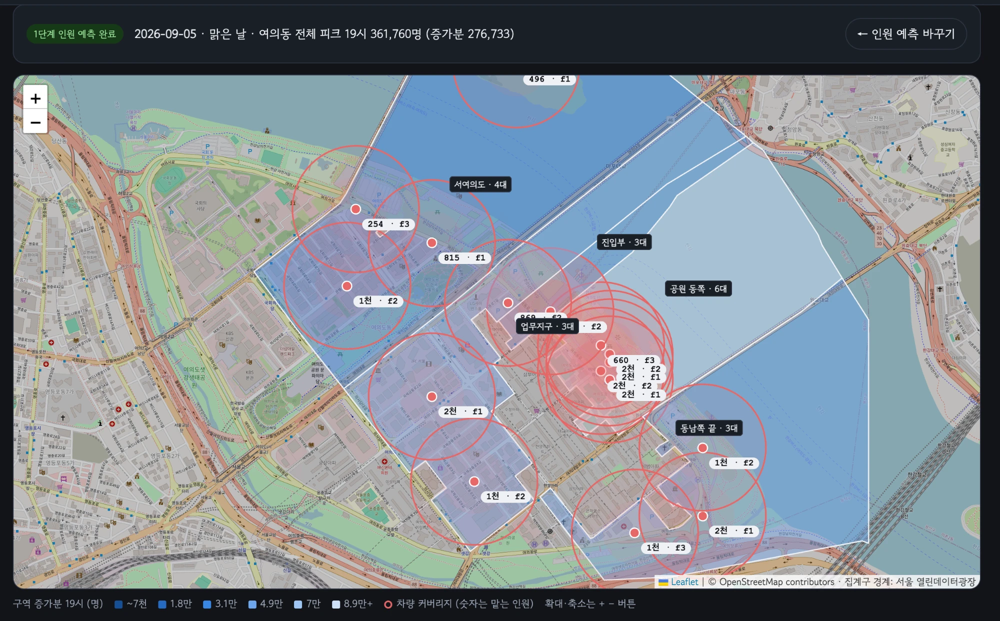
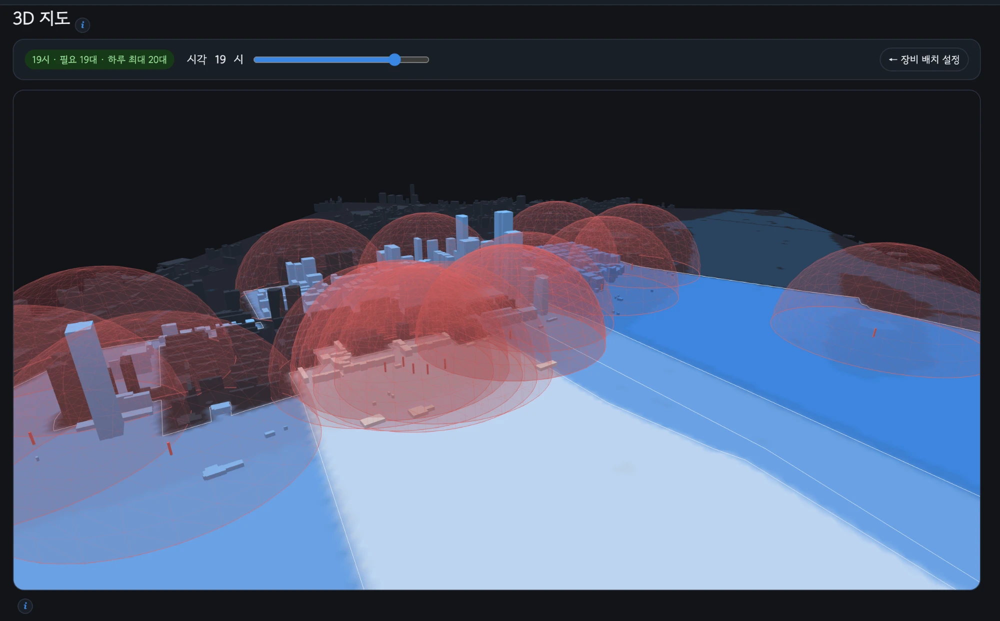

# festival-crowd-telecom — 축제 통신 대응을 위한 인파 예측

여의도 서울세계불꽃축제에는 매년 대규모 인파가 몰려 통신 수요가 크게 늘어난다. 통신사가 이동기지국을 미리 배치하려면 **언제, 어디에 사람이 몰리는지** 알아야 한다. 이 레포는 공공데이터로 **날짜와 날씨를 넣으면 구역별·1시간 단위 예상 인원이 나오는 모델**을 만들었다.

2026 하반기 공공데이터분석대회 TEAM 치앙마이 프로젝트 「축제 인원 예측 및 통신 최적화」 중 **인원 예측 파트**의 코드와 기록이다. 통신장비 모델은 이 레포에 없다.

```
예측 인원 = 구역별 평소 인원 모델 + 축제 증가분 × 보정 계수
```

- 평소 모델 6가지를 시계열 교차검증으로 비교해 **그래디언트 부스팅**을 채택했다 (6구역 평균 MAPE 14.2%).
- 최근 불꽃축제 4회를 하나씩 빼고 맞혀 본 결과, 여의동 전체 피크 오차는 **±9% 이내**, 피크 시각은 **4회 모두 일치**했다.


## 활용 데모

예측 결과를 통신장비 모델과 결합해 이동기지국 배치를 보여 주는 팀 데모 화면이다 (데모 코드는 이 레포에 없다).

<table>
<tr>
<th width="50%">현재 서비스: 2D 배치 지도</th>
<th width="50%">발전 방향: 3D 지도</th>
</tr>
<tr>
<td></td>
<td></td>
</tr>
<tr>
<td valign="top">날짜를 넣으면 19시 피크 인원과 구역별 축제 증가분을 색으로 보여 주고, 필요한 기지국 차량 대수와 위치, 차량별 커버리지·수용 인원을 지도에 표시한다.</td>
<td valign="top">건물 높이와 위치를 반영한 3D 지도. 앞으로 안테나 높이에 따른 통신차량 성능 차이를 파악한다면, 건물에 가려지는 영역까지 고려해 차량 배치와 안테나 방향을 정하는 데 활용할 수 있다.</td>
</tr>
</table>

## 데이터

| 데이터 | 출처 | 사용 내용 |
|---|---|---|
| 서울 생활인구 (KT 통신 데이터 기반 집계구별 1시간 인원) | 서울 열린데이터광장 [OA-14979](https://data.seoul.go.kr/dataList/OA-14979/F/1/datasetView.do) | 1.9만 개 집계구 중 여의동 68개 추출, 5개 구역 + 여의동 전체로 집계 |
| 서울시 문화행사 정보 (19,583건) | 서울 열린데이터광장 [OA-15486](https://data.seoul.go.kr/dataList/OA-15486/S/1/datasetView.do) | 여의도 야외 행사 47건(행사일 120일)을 행사일 달력으로 반영 |
| 서울 집계구 경계 (2016) | 서울 열린데이터광장 [서울 생활인구 자료실](https://data.seoul.go.kr/dataVisual/seoul/seoulLivingArchive.do) | 인파가 몰리는 큰 집계구 5개를 구역으로 정함 |
| 시간별 날씨 (ERA5 재분석) | [Open-Meteo](https://open-meteo.com/en/docs/historical-weather-api) | 여의도 지점의 기온, 강수 등 |

원본 4종 약 55GB에서 여의동만 추출해 약 230만 행, 이를 구역별·1시간 표로 묶어 분석용 33,864행을 만들었다.

## 전처리

1. **추출**: 생활인구 ZIP을 풀지 않고 한 줄씩 읽어 여의동 집계구만 남겼다.
2. **구역 정의**: 축제일 인파가 몰리는 집계구 5개(공원 동쪽, 진입부, 서여의도, 동남쪽 끝, 업무지구)와 여의동 전체, 6개 구역. 지도는 [`docs/여의도_집계구_지도.html`](docs/여의도_집계구_지도.html)에 있다.
3. **정리**: 연도마다 다른 인코딩을 통일하고, 원본이 빈 날은 결측으로 뺐다.
4. **결합**: 1시간 단위로 시각·요일·공휴일·계절·날씨를 붙였다.
5. **학습 표본**: 축제가 토요일이라 평일은 빼고, 행사일 달력의 행사일도 뺐다. 2023.01–2026.07의 토·일·공휴일 367일이 남았다.

- 문화행사 목록에 없는 큰 행사·집회 7건은 뉴스로 날짜를 확인해 추가했다 ([`manual_events.csv`](data/raw/events/manual_events.csv)). 모델 비교 중 오차가 한 구간에서만 튀어 추적해 보니 국회 앞 대규모 집회였던 것이 계기다.
- **2017–2019년은 평소 모델 학습에서 뺐다.** 최근 모델을 그 시기에 적용하면 업무지구 인구를 약 8–13% 높게 예측했다. 그래서 당시 평소 인원은 같은 달 주변 토요일의 시간별 중앙값으로 따로 계산했다.

## 평소 인원 모델

### 후보와 검증

| 방법 | 설명 |
|---|---|
| ① 요일×시간 평균 | 과거 같은 요일·같은 시각의 평균 (기준선) |
| ② 월×요일×시간 평균 | ①에 월을 추가 |
| ③ 선형회귀 (Ridge) | 변수별 효과를 더해서 예측 |
| ④ 랜덤포레스트 | 나무 300개의 평균 |
| ⑤ 그래디언트 부스팅 | 앞 나무의 오차를 고쳐 가며 나무 400개를 순서대로 쌓음 |
| ⑥ 그래디언트 부스팅 + 튜닝 | 설정 후보 8개 중 최선을 고름 |

- **시계열 교차검증**: 데이터를 섞지 않고 시간 순서대로 4개 시험 구간을 예측했다. 4구간 성능을 평균해 특정 기간에만 잘 맞는 모델을 피했다.
- 설정은 각 학습 기간의 마지막 20%를 검증용으로 두고 골랐다.
- 지표는 MAPE(오차율, %)를 주기준으로, MAE(평균 몇 명 틀리는지)를 보조로 썼다.

### 결과

| 방법 | 특징 | 6구역 평균 MAPE |
|---|---|---|
| 단순 평균 2종 | 날씨·추세 반영 불가 | 22.4–23.2% |
| 선형회귀 | 변수 간 조합을 못 잡음 | 21.4% |
| 랜덤포레스트 | 4개 구역에서 그래디언트 부스팅보다 뒤짐 | 15.0% |
| **그래디언트 부스팅 (채택)** | 튜닝해 봤지만 차이 없음 | **14.2%** |
| 그래디언트 부스팅 + 튜닝 | 개선 없이 복잡도만 늘어남 | 14.2% |

- 6구역 평균 오차율이 가장 낮고, 불꽃축제의 핵심인 강변 구역(공원 동쪽, 진입부)에서도 더 낮아 그래디언트 부스팅을 채택했다.
- 변수 중요도를 보면 가장 중요한 변수는 모든 구역에서 **시각**이었다. 그다음은 구역마다 달라, 강변은 기온, 서여의도는 요일(일요일 오전 교회)의 영향이 컸다.

구역별 수치는 [`outputs/model_compare/`](outputs/model_compare/)에 있다.


## 축제 증가분과 보정 계수

- **축제 증가분** = 2022–2025년 4회의 시간대별 (실제 − 평소) 평균. 2017–2019년은 증가분이 약 30% 작고 피크가 1시간 늦어 넣지 않았다.
- **보정 계수** = 2018년 증가분 ÷ 2017·2019년 평균 증가분. 불꽃축제 7회 중 비가 온 해는 2018년뿐이라, 비가 오면 증가분이 맑은 날의 몇 %가 되는지를 이 한 해로 잡았다.

회차별·구역별 검증 결과는 [`outputs/predict/불꽃축제_하나씩빼고_검증.csv`](outputs/predict/불꽃축제_하나씩빼고_검증.csv)에 있다.

## 실행

```bash
pip install -r requirements.txt
python3 scripts/baseline_model.py              # 평소 모델 학습·검증
python3 scripts/model_compare.py               # 6가지 방법 비교 (약 25분)
python3 scripts/fireworks_increment.py         # 불꽃축제 증가분
python3 scripts/predict_fireworks.py 2026-09-05                      # 예측 (날씨는 평년값)
python3 scripts/predict_fireworks.py 2026-09-05 --tmax 28 --tmin 20  # 최고·최저 기온 지정
python3 scripts/predict_fireworks.py --backtest                      # 하나씩 빼고 검증
```

레포에 든 가공 데이터(`data/processed/`)만으로 위 명령이 모두 돌아간다. 원본은 용량 때문에 넣지 않았고, 처음부터 다시 만들려면 `fetch_yeouido_pop.py` → `fetch_weather.py` → `build_panel.py` → `build_event_calendar.py` 순서로 돌린다 (각 스크립트 첫머리에 사용법이 있다). 과거 불꽃축제 달의 날씨(`weather_yeouido_hourly_past.csv`)는 `fetch_weather.py`로 받은 뒤 파일 이름을 바꿔 둔 것이다.

## 구조

```
scripts/     수집 → 전처리 → 모델 → 예측 스크립트 9개
data/        가공 데이터, 직접 추가한 행사 목록
outputs/     검증표, 비교표, 그림
docs/        결과 요약, 작업 기록, AI 활용 기록, 구역 지도, 데모 화면
```

## 한계

- 생활인구는 통신 신호로 추정한 값이고, 날씨는 관측값이 아니라 재분석값이다.
- 축제 증가분은 4회, 보정 계수는 1회로 만들어 표본이 작다.
- 집계구 단위 생활인구는 2026년 7월에 생산이 끝나 이후 예측은 실제 값으로 확인할 수 없다.

## 출처와 라이선스

- 서울 생활인구, 집계구 경계, 문화행사 정보: 서울 열린데이터광장, 공공누리 제1유형
- 날씨: [Open-Meteo](https://open-meteo.com/) (CC BY 4.0)
- 지도: © [OpenStreetMap](https://www.openstreetmap.org/copyright) contributors
- 코드는 Claude Code와 함께 작성했다 (`docs/프롬프트로그_모델링.md`).
